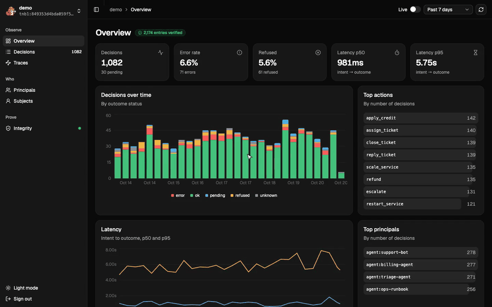

<p align="center">
  
</p>

<h1 align="center">Tenbri</h1>

<p align="center"><strong>The open-source Agent Decision Record: every decision signed, chained and provable.</strong></p>

<p align="center">
  <a href="https://scorecard.dev/viewer/?uri=github.com/tenbri/tenbri"></a>
  <a href="https://github.com/tenbri/tenbri/actions/workflows/ci.yml"></a>
  <a href="https://crates.io/crates/tenbri"></a>
  <a href="https://pypi.org/project/tenbri/"></a>
  <a href="https://www.npmjs.com/package/tenbri"></a>
  <a href="LICENSE"></a>
</p>

An Agent Decision Record is a signed, append-only record of every decision an AI agent makes:
who acted, under which rule and inputs, who approved, and what happened, verifiable offline by
anyone.

Tenbri is the open-source one: a tamper-evident audit trail for AI agents. It is written in Rust, stores plain files
on a local disk or an object store, and verifies offline against a trust root the verifier controls.
It works on its own, with any agent framework, from Rust, Python, Node, the browser (WASM), the
`tenbri` CLI or the `tenbrid` REST and gRPC API.

## Quickstart

```bash
cargo install tenbri-cli --version ^0.1.0-beta.1
tenbri init ./audit/support
echo '{"kind":"decision","phase":"intent","source":"sdk","principal":{"kind":"agent","id":"support-bot"},"action":{"type":"reply_ticket","target":"zendesk:ticket/1042"}}' | tenbri append ./audit/support
tenbri query ./audit/support
tenbri show ./audit/support 3
tenbri verify ./audit/support
```

`init` pins the stream's key on this machine, so `verify` checks against it (the Python and Node
`init()` record it too); anyone else passes `--key` with the fingerprint `init` printed. Set `TENBRI_STREAM=./audit/support` to leave the path
out, and see `tenbri append --help` for the entry format.

## Tenbri UI

`tenbrid` serves a read-only web UI at its root. Open http://127.0.0.1:7070 and sign in with a
stream name and a bearer token (`tenbrid token` makes one).

<p align="center">
  
</p>

- **Overview**: decisions, error and refusal rates, intent-to-outcome latency, top actions and principals.
- **Decisions**: every intent joined with its outcome, with search, filters by status, action and principal, and column picker.
- **Decision and trace views**: a timeline of approval, intent and outcome (or every decision in one OpenTelemetry trace), with each entry's fields, chain links and a receipt download.
- **Principals** and **Subjects**: who acted, and what was decided about whom.
- **Integrity**: whether the stream verifies against its pinned key, the head, the latest checkpoint and the key history.

The token stays in the browser tab; the UI reads the same REST API as any client and cannot
write. Its source is in [`ui/`](ui/README.md).

## The problem

Companies now give agents real authority: refunds, payments, account changes, production deploys,
security responses. Afterwards they cannot prove what an agent did, what it saw, which rule allowed
it, or who signed off.

- **A customer disputes a refusal.** Support can show the reply, but not which policy version,
  contract clause and permission produced it.
- **An incident happens**: a wrong payment, a deleted record, an account disabled by mistake.
  Engineers rebuild the story from logs in five services, each editable by the people being
  investigated.
- **A policy changes.** Nobody can list the decisions made under the old wording, so nobody can
  review them.
- **An auditor asks for evidence.** Teams send screenshots and CSV exports that prove nothing about
  integrity.
- **A prompt injection makes an agent act.** There is no record of what the agent read that led to
  the action.

Regulation is moving the same way. Tenbri gives you the records these ask for; it does not make a
system compliant on its own.

- **EU AI Act** [Article 12](https://artificialintelligenceact.eu/article/12/),
  [Article 19](https://artificialintelligenceact.eu/article/19/) and
  [Article 26](https://artificialintelligenceact.eu/article/26/): automatic logs over a high-risk
  system's lifetime, kept at least six months. Tenbri keeps every decision signed and chained, on
  storage you control.
- **EU AI Act** [Article 14](https://artificialintelligenceact.eu/article/14/): human oversight.
  Approvals and overrides are their own signed entries.
- **GDPR** [Article 22](https://gdpr-info.eu/art-22-gdpr/): human review of automated decisions and
  the means to contest them. Each decision names its inputs, rule and approver; personal data can be
  erased without breaking the chain.
- [**DORA**](https://eur-lex.europa.eu/eli/reg/2022/2554/oj) and
  [**NIS2**](https://eur-lex.europa.eu/eli/dir/2022/2555/oj): incident reporting and evidence of
  control. A timeline of what agents did that no one could edit afterwards.
- [**SOC 2**](https://www.aicpa-cima.com/topic/audit-assurance/audit-and-assurance-greater-than-soc-2),
  [**ISO/IEC 27001**](https://www.iso.org/standard/27001) and
  [**ISO/IEC 42001**](https://www.iso.org/standard/42001): evidence that controls work. Receipts an
  auditor verifies offline, without access to your systems.
- [**NIST AI RMF**](https://www.nist.gov/itl/ai-risk-management-framework): traceability and
  accountability of AI decisions. Who acted, under which policy version, and the trace that
  produced it.

## Why not just logs?

Logs tell operators what happened. Tenbri gives anyone, including someone who does not trust the
operator, proof of what an agent decided and why.

| | Application logs | Tenbri |
|---|---|---|
| Integrity | Editable, rotated, deleted | Hash-chained and signed; any change fails verification |
| Who acted | A shared service account | The specific agent, person or service, with its own key |
| What it saw | Free text, if anything | Inputs pinned by reference, version and content hash |
| Why it was allowed | Rarely recorded | The rule or grant that allowed or refused it |
| Human oversight | A Slack thread, if anything | The approval, as its own signed entry |
| Timing | After the fact | The intent before the action, the outcome after |
| Sharing with an auditor | Give them access to your systems | A receipt that verifies on its own, offline |
| Personal data | Copied into log lines | Only hashes in the chain; bodies encrypted and erasable |

Tenbri does not replace logs, traces or observability tools: it records decisions and links to the
trace that produced them (OpenTelemetry trace and span ids).

## Status

**Pre-release: `0.1.0-beta.1` is out; nothing here is ready for production yet.** The code lands
on the way to v0.1.0 through `0.1.0-alpha`, `-beta` and `-rc` pre-releases
([CONTRIBUTING.md](CONTRIBUTING.md#releases)). Records written by pre-releases are not covered by the
format promise: the format is provisional until its external review ends ([spec/](spec/README.md)).

v0.1.0 ships every feature below, each labelled:

- **Stable**: covered by the format promise and the 0.x API policy.
- **Experimental**: behind a Cargo feature or an experimental module, documented and tested, free
  to change in a 0.x minor release.

✅ done · 🚧 in progress · ⬜ to do

| Area | Stable | Experimental |
|---|---|---|
| Format and integrity | ✅ Entry format v1 · ✅ canonical bytes · ✅ hash chain · ✅ signatures · ✅ intent and outcome entries · ✅ links · ✅ Merkle checkpoints · ✅ receipts | |
| Keys | ✅ Stream and session keys · ✅ rotation · ✅ revocation · ✅ key file · ✅ OS keychain (macOS, Windows) | ⬜ PKCS#11 · ⬜ cloud KMS · ⬜ passkey attestations |
| Storage | ✅ Local disk · 🚧 AWS S3 (tested on MinIO; real S3 before rc.1) · ✅ Cloudflare R2 · ✅ MinIO | ⬜ Google Cloud Storage · ⬜ Azure Blob · ⬜ Postgres |
| Anchoring | ⬜ Checkpoint publishing to auditors · ✅ RFC 3161 timestamps | ⬜ Sigstore Rekor · ⬜ witnesses |
| Privacy | ✅ Blob encryption · ✅ per-subject keyed digests and erasure · ✅ local key store | |
| Query | ✅ SQLite or Parquet index | ⬜ `--as-of` time travel · ⬜ Iceberg index |
| CLI | ✅ init · ✅ append · ✅ verify · ✅ query · ✅ tail · ✅ checkpoint · ✅ receipt · ✅ keys · ✅ erase · ✅ index · ✅ schema check · ⬜ gc | ⬜ export · ⬜ mcp · ⬜ proxy · ⬜ ingest |
| Bindings | ✅ Rust · ✅ Python · ✅ Node · ✅ WASM verifier | |
| Adapters | ✅ Claude Agent SDK · ✅ OpenAI Agents SDK · ✅ LangGraph and LangChain | ⬜ Pydantic AI · ⬜ Vercel AI SDK · ⬜ Mastra · ⬜ Google ADK · ⬜ AWS Strands · ⬜ Microsoft Agent Framework · ⬜ CrewAI · ⬜ LlamaIndex · ⬜ A2A |
| Fleet and liveness | ⬜ `action.net` target fields (host, IP, port) · ⬜ indexed host, IP and domain · ⬜ `query --target-domain` and `--target-ip` | ⬜ run registration and silent-stream alerts in tenbrid · ⬜ proxy-observed entries · ⬜ `query --unmatched` |
| APIs and tooling | ✅ tenbrid REST and gRPC · ✅ action schemas · ✅ OpenTelemetry correlation · ⬜ webhook and OTLP streaming · ✅ test kit · ⬜ C2SP tiles and witness protocol | ⬜ Generated Go, Java and .NET clients · ⬜ Kafka · ✅ Tenbri UI, read-only (tenbrid serves it at `/`) · ⬜ OpenLineage and W3C PROV exports |

## Non-goals

Multi-writer consensus, a blockchain or token, a general-purpose database, storing raw telemetry or
full prompts by default, judging whether a decision was correct, telemetry of any kind, and a hosted
service.

## Layout

| Path | What |
|---|---|
| `crates/tenbri` | The facade crate users depend on |
| `crates/tenbri-*` | Core, merkle, keys, store, writer, crypt, index, anchor, export, macros, mcp, proxy, otlp, server (`tenbrid`), stream, schema, tiles, testkit, cli (`tenbri`) |
| `bindings/python`, `bindings/node`, `bindings/wasm` | The `tenbri` wheel, the `tenbri` npm package, `@tenbri/wasm` |
| `spec/` | The format specification and its test vectors |

## Contributing

[CONTRIBUTING.md](CONTRIBUTING.md), [GOVERNANCE.md](GOVERNANCE.md),
[CODE_OF_CONDUCT.md](CODE_OF_CONDUCT.md). Security reports: [SECURITY.md](SECURITY.md).

## License

[Apache-2.0](LICENSE). The test vectors in `spec/vectors/` are [CC0](spec/vectors/README.md).
